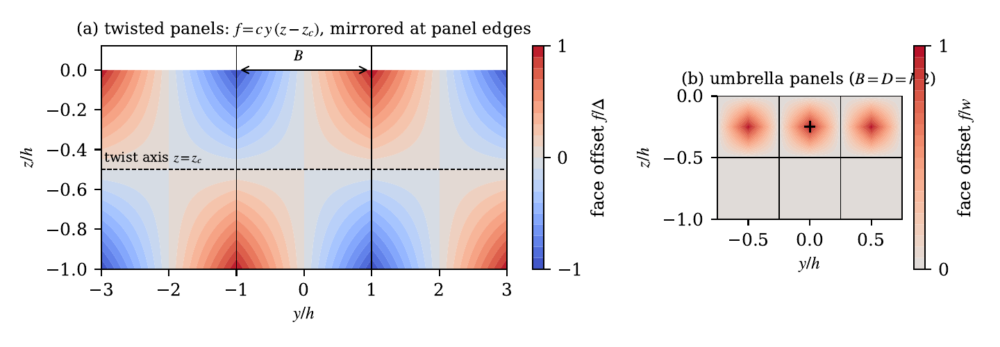
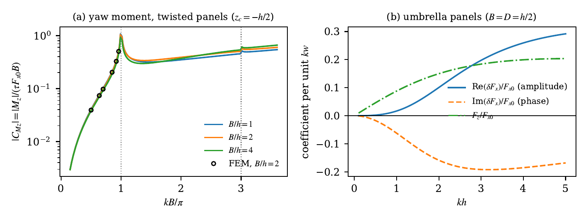

# Hypar-WaveLoad-Theory
First-order linear wave theory and independent finite element (FE) verification for wave loads on warped (hyperbolic paraboloid) vertical faces of coastal structures.



*Face-offset maps of the two hypar panel families, viewed from the sea. (a) Twisted straight-edged panels, f = c y (z - z_c), mirrored about each panel edge, with corner offsets ±Δ. (b) Candela-type umbrella panels with vertex offset w and face height D = h/2.*



*(a) Yaw moment coefficient of twisted panels versus kB/π, showing the amplification near the transverse cutoff (lines: theory; markers: independent FE solution). (b) First-order in-line and vertical forces on umbrella panels per unit kw.*

## Repository structure

- `src/` Python modules for the first-order theory, the FE verification solver, symbolic checks, verification cases, finite-warp sweeps, and figure generation.
  - `theory.py` first-order modal (eigenfunction-expansion) solution and closed-form results.
  - `fem.py` FE solver of the exact linear problem (warp not linearized), with a modal Dirichlet-to-Neumann radiation boundary.
  - `geometry.py` twisted and umbrella hypar face definitions.
  - `tests.py`, `symbolic_checks.py`, `verify.py`, `sweeps.py`, `figures.py` scripts reproducing the results of the paper.
- `data/` FE results used in the paper (finite-warp sweeps, transverse-cutoff study, verification).
- `figures/` Figures of the paper, generated by `src.figures`.

## Installation

```bash
pip install -r requirements.txt
```

## Usage

- **Sanity tests against exact solutions**

```bash
python -m src.tests
```

- **Symbolic checks** (first-order wall condition and pressure centroid)

```bash
python -m src.symbolic_checks
```

- **Verify the theory against the FE solution** (Table 1)

```bash
python -m src.verify --case=twist --mesh=medium
```

- **Available cases**: `twist`, `umbrella`, `umbrella-square`, `cutoff`

- **Finite-warp sweeps** (Fig. 5)

```bash
python -m src.sweeps --case=twist --values 0 0.1 0.2 0.4
```

- **Reproduce all figures**

```bash
python -m src.figures
```

All quantities are non-dimensional (ρ = g = A = h = 1): forces per ρgAh², moments per ρgAh³. Each FE solve takes approximately 5 to 40 s on a single CPU core.

## Abstract

**Wave loads on warped vertical faces: Symmetry rules, first-order theory, and implications for hyperbolic paraboloid coastal structures**  
Sam Smith  
Department of Civil Engineering, Kansas State University, Manhattan, KS 66506, United States

Hyperbolic paraboloid (hypar) and other warped surfaces have been proposed as the seaside faces of breakwaters and coastal barriers, yet the effect of face warping on wave loads has only been examined numerically and for a limited set of geometries. This paper develops a linear potential-flow theory for regular waves acting on a vertical wall with a warped face, considering a long structure composed of repeated panels. First, an exact mirror-symmetry selection rule is established: the antisymmetric part of the warp, such as that of a twisted straight-edged hypar panel, changes the in-line force, vertical force, and overturning moment only at second order, while it alone generates lateral force, roll moment, and yaw moment. Second, a first-order theory is derived and solved by eigenfunction expansion. It is shown that the first-order in-line, vertical, and overturning loads depend only on the width-averaged face profile. Closed-form expressions are provided for the lateral force and roll moment of twisted panels, including a pressure-centroid rule under which the lateral force vanishes. The yaw moment is amplified as the panel width approaches half the wavelength, a transverse cutoff that also affects single-panel flume studies. An independent finite element solution of the exact linear problem confirms the theory to within 1.4% and defines its range of validity. Within linear theory, warping is nearly load-neutral for the in-line force, suggesting that the benefits reported for hypar faces originate from nonlinear and dissipative mechanisms and from shell action.

## Citation

The citation will be added upon publication.
